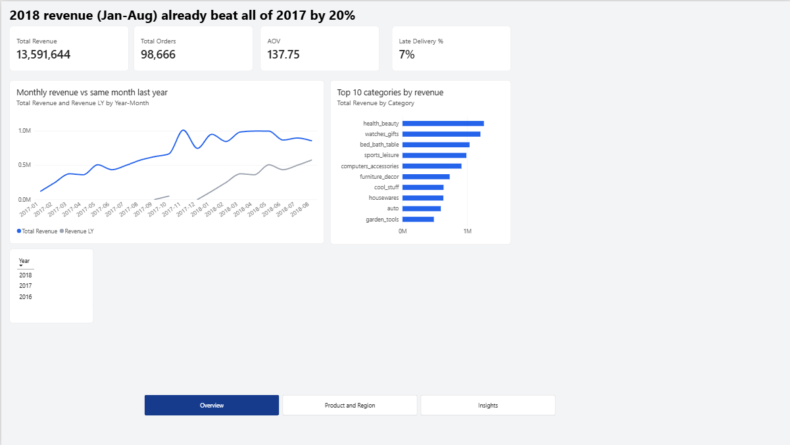
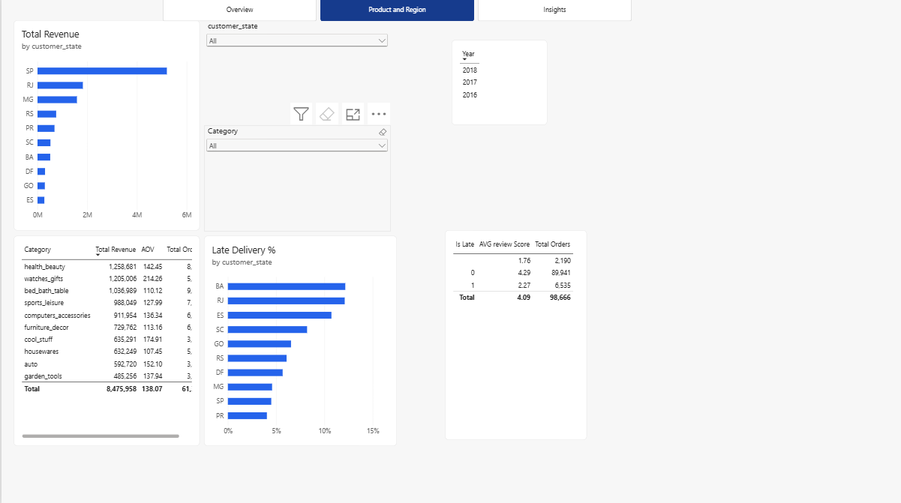
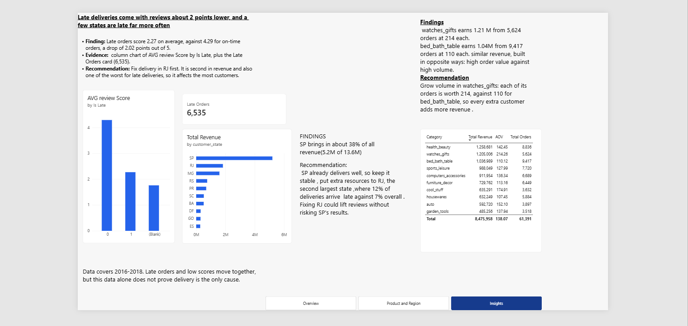
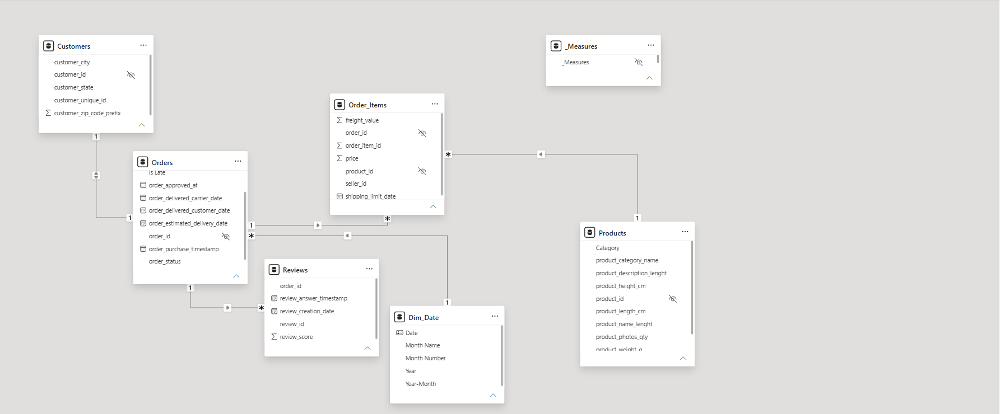

# Olist E-commerce Performance Dashboard (Power BI)

A three-page Power BI report on the Olist Brazilian e-commerce dataset (2016-2018). It answers three questions a manager would ask: how big is the business and is it growing, which states and categories bring the money, and does late delivery hurt customer reviews.

## Business problem

1. **How big is the business, and is it growing?** Revenue, orders, average order value (AOV) and late delivery rate, compared with the same month last year.
2. **Where does the money come from?** Revenue by state and by product category.
3. **Does late delivery hurt reviews, and where is it worst?** Review scores for late and on-time orders, and late delivery % by state.

## Data

Olist Brazilian E-Commerce dataset (Kaggle). Tables used: orders, order items, customers, products, product category translation and reviews.

## What I built

- **Power Query:** fixed data types, created the `Is Late` and `Delay Days` columns, merged the category translation table, and removed two free-text columns from the reviews table.
- **Data model:** `Dim_Date`, `Customers`, `Products`, `Orders`, `Order_Items` and `Reviews`, connected with one-to-many relationships (see `04-model.png`). Key columns are hidden so the field list stays clean.
- **DAX measures:** Total Revenue, Total Orders, AOV, Late Delivery %, Late Orders, Revenue LY, Revenue YoY %, Orders LY, Orders YoY %, Revenue incl. Freight, AVG review Score.
- **Three report pages:** Overview, Product and Region, Insights, with page navigation buttons, slicers and one font and colour theme.

## Key findings

1. **The business grew strongly.** Total revenue is 13.59M from 98,666 orders, with an AOV of 137.75. Revenue for Jan-Aug 2018 already beat all of 2017 by 20%.
2. **One state carries the business.** São Paulo (SP) brings in about 38% of all revenue (5.2M of 13.6M). RJ is second, and RJ also has one of the highest late delivery rates, about 12% against 7% overall.
3. **Late orders get much lower reviews.** Late orders score 2.27 on average against 4.29 for on-time orders, a drop of 2.02 points out of 5. 6,535 orders were late. Orders with no delivery date have the lowest score, 1.76.
4. **Two categories earn similar revenue in opposite ways.** `watches_gifts` earns 1.21M from 5,624 orders at 214 each. `bed_bath_table` earns 1.04M from 9,417 orders at 110 each. One is built on order value, the other on volume.

## Recommendations

- Put extra delivery resources into RJ, the second-largest state, and keep SP stable.
- Grow order volume in `watches_gifts`, because each order is worth about twice as much as a `bed_bath_table` order.

## Screenshots

## Limitations

- The data covers 2016-2018, and 2018 only runs to August, so the 2018 revenue figures are a partial year.
- Late orders and low review scores move together, but this data alone does not prove that delivery is the only cause.
- The Year slicer is not synced between pages.
- Clicking a category does not change Late Delivery % or the review score, because filters in the model travel in one direction and cannot reach the Orders table from Products.

## What I would do next

- Check whether product mix, sellers or review counts explain the lower on-time scores in BA.
- Add a text label ("On time" / "Late") for the `Is Late` column so chart axes are easier to read.
- Fix the category-to-delivery filter so late delivery can be compared by product category.

## How to open

Download `olist_dashboard.pbix` and open it with Power BI Desktop (Windows).
